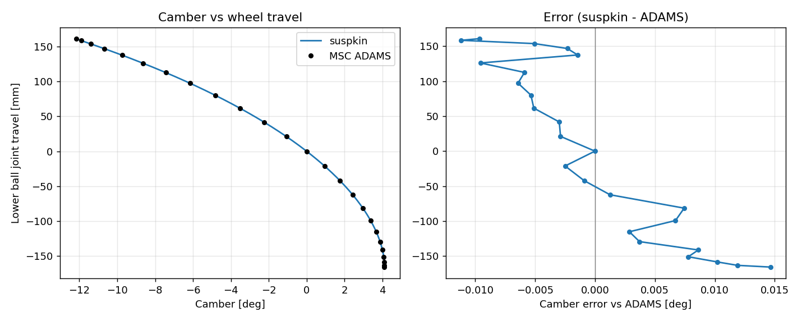
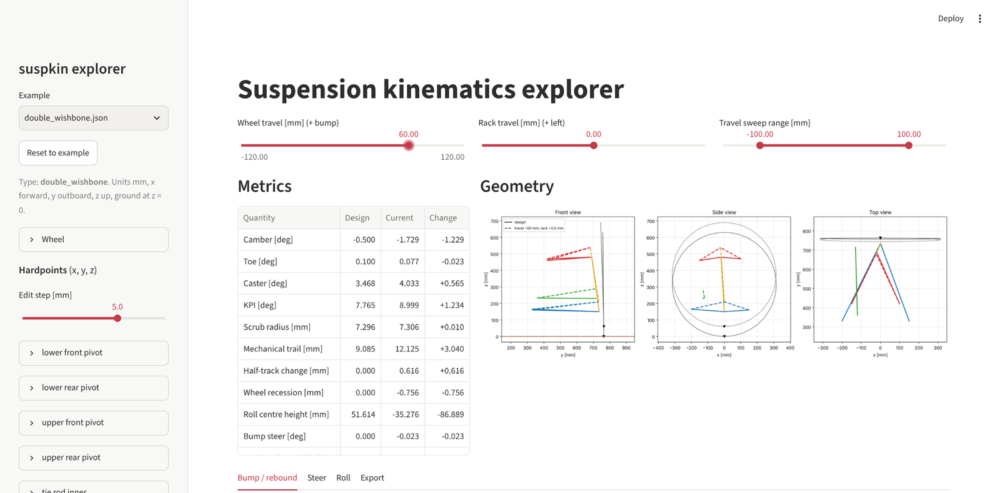
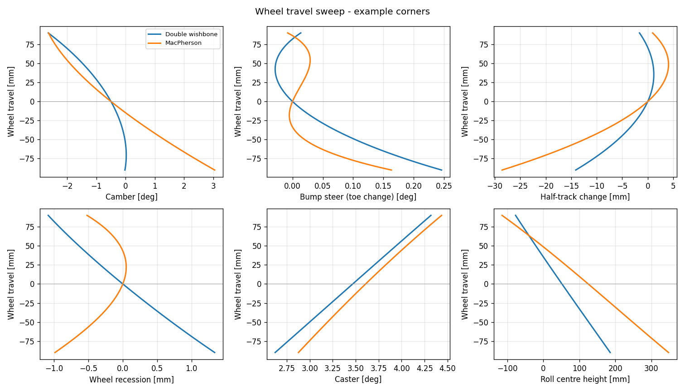
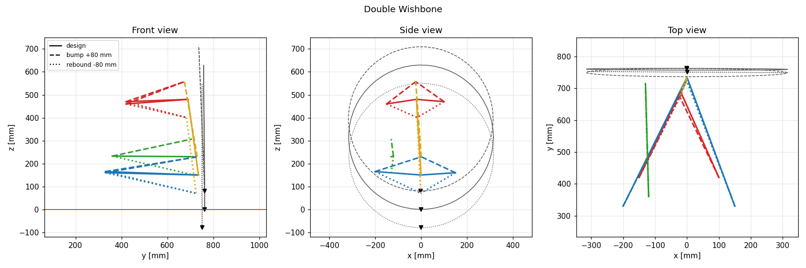

# suspkin: suspension kinematics in Python

[](https://github.com/echod-wmg/suspension-kinematics/actions/workflows/tests.yml)

`suspkin` computes the 3-D kinematics of **double wishbone** and **MacPherson
strut** suspensions: camber, toe / bump steer, caster, kingpin inclination,
scrub radius, mechanical trail, half-track change, wheel recession and the
front-view roll centre. It covers bump/rebound, steering and body-roll sweeps.

It comes from my 2020 BEng individual project at Coventry University,
*"Design of a tool for kinematics development of the double wishbone and
McPherson suspension systems"*. The original Excel tool is kept in
[`legacy/`](legacy/).



*Camber against wheel travel, compared with MSC ADAMS. The solver agrees
with ADAMS to within **0.015°** over ±160 mm of travel.*

## Install

```bash
git clone https://github.com/echod-wmg/suspension-kinematics.git
cd suspension-kinematics
python -m venv .venv && source .venv/bin/activate
pip install -e ".[dev]"
```

You need Python ≥ 3.9. The runtime dependencies are only numpy, pandas and matplotlib.

## Quick start

### Command line

```bash
suspkin info  examples/double_wishbone.json            # static geometry + gradients
suspkin sweep examples/macpherson.json --out results    # CSV + PNG for travel / steer / roll
suspkin sweep examples/excel_default_2020.json --travel -150 150 5
suspkin hardpoints examples/excel_default_2020.json     # convert legacy Excel inputs to 3-D hardpoints
```

### Interactive explorer

```bash
pip install -e ".[app]"
streamlit run app/streamlit_app.py
```

Pick an example, edit hardpoints and wheel data in the sidebar, and move the
travel and steer sliders. Metrics, the three-view geometry and the bump,
steer and roll sweeps update live. Edited models can be downloaded as JSON.



### Python

```python
import numpy as np
from suspkin import load_model, travel_sweep, steer_sweep, summary

dw = load_model("examples/double_wishbone.json")
print(summary(dw)["camber_gain_deg_per_10mm"])

df = travel_sweep(dw, np.arange(-80, 81, 5))    # pandas DataFrame
df[["travel_mm", "camber_deg", "bump_steer_deg", "roll_centre_height_mm"]]

state = dw.solve(travel=40.0, rack=10.0)        # one position
state["upper_ball_joint"], state.spindle
```




## Defining a suspension

Models are JSON files. Hardpoints use a left-hand corner in vehicle
coordinates: **x forward, y outboard (left), z up**, in mm, with the ground at
`z = 0` in the design position.

```jsonc
{
  "type": "double_wishbone",              // or "macpherson"
  "hardpoints": {
    "lower_front_pivot": [150, 330, 160],  "lower_rear_pivot": [-200, 330, 165],
    "lower_ball_joint":  [0, 735, 150],
    "upper_front_pivot": [100, 420, 470],  "upper_rear_pivot": [-150, 420, 460],
    "upper_ball_joint":  [-20, 690, 480],
    "tie_rod_inner": [-120, 360, 232.5],   "tie_rod_outer": [-130, 715, 230],
    "wheel_centre":  [0, 760, 315]
  },
  "wheel": {"radius": 315, "width": 215, "static_camber_deg": -0.5, "static_toe_deg": 0.1}
}
```

A MacPherson model replaces the upper arm with `strut_top_mount` (on the body)
and `strut_lower` (a point on the strut axis fixed to the knuckle). The
[`examples/`](examples/) folder has both types, plus the 2020 parametric
models (`"type": "excel_double_wishbone"`).

Travel is the vertical movement of the wheel centre by default. Set
`"travel_reference": "lower_ball_joint"` to measure it at the ball joint, as
the ADAMS validation does.

### Sign conventions

| Quantity | Positive when |
|---|---|
| Camber | top of the wheel leans outboard |
| Toe | toe-in (front of the wheel points inboard) |
| Caster | top of the steering axis is rearward |
| KPI | top of the steering axis is inboard |
| Scrub radius | steering axis meets the ground inboard of the contact patch |
| Mechanical trail | steering axis meets the ground ahead of the contact patch |
| Half-track change | contact patch moves outboard |
| Wheel recession | wheel centre moves forward |
| Rack | inner tie rod moves towards +y |

## How it works

The knuckle (upright plus wheel) is one rigid body with six degrees of freedom:
a rotation vector applied with the Euler–Rodrigues formula, plus a translation.
Each link adds scalar constraints:

* **wishbone**: the ball joint stays a fixed distance from both inner pivots
  (2 equations per arm)
* **tie rod**: the outer joint stays a fixed distance from the inner joint,
  which moves with the rack (1 equation)
* **MacPherson strut**: the top mount stays on the knuckle-fixed strut axis
  (2 equations)
* **driver**: the wheel centre (or ball joint) sits at the requested height
  (1 equation)

The solver (`suspkin/solver.py`) runs Gauss-Newton with a finite-difference
Jacobian and a backtracking line search. Sweeps start at the design position
and step outwards, so each solve begins next to the previous one and stays on
the assembled branch. Metrics come from the solved hardpoints and the spindle
axis.

The roll-centre height is the front-view construction for a symmetric axle.
The instant centre is where the traces of the two arm planes intersect (for a
MacPherson strut: the lower arm and the line through the top mount
perpendicular to the strut). The roll centre is where the line from the
contact patch through that instant centre crosses the vehicle centreline.

## Validation

`python validation/validate_adams.py` runs the ADAMS validation case
(`examples/adams_validation_2020.json`) and compares camber against the ADAMS
results in `validation/adams_2020_table1.csv`. The maximum error is
**0.015°**, about the rounding of the ADAMS values. The test suite also checks
the solver against a closed-form planar four-bar solution to 1e-8 mm.

## Limitations

* Kinematics only: rigid links and ideal joints, with no bushing compliance
  and no tyre deflection. The contact patch is the lowest point of a thin rigid
  wheel.
* Body roll assumes a symmetric axle rolling about a ground-level axis
  (wheel travel = half-track × tan φ).
* No anti-dive or anti-squat yet, and no motion ratio or spring and damper
  geometry beyond the strut length.

## Project history

* **2020**: BEng (Hons) Automotive Engineering individual project, Coventry
  University. Excel tool for double wishbone and McPherson kinematics,
  validated against MSC ADAMS.
  [Report (PDF)](docs/report/2020_BEng_report_suspension_kinematics.pdf) ·
  [Presentation (PDF)](docs/report/2020_BEng_presentation_suspension_kinematics.pdf)
* **2026**: Python package with a 3-D solver, interactive explorer, tests
  and CI.

## License

[MIT](LICENSE)
